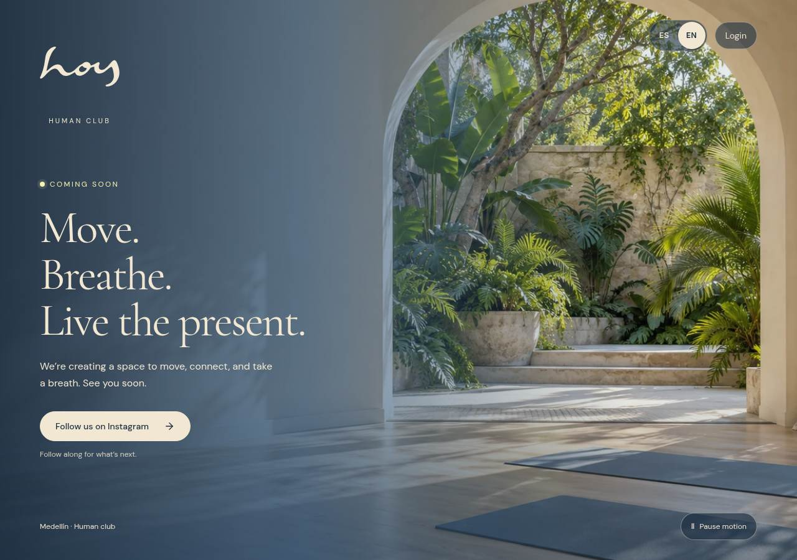
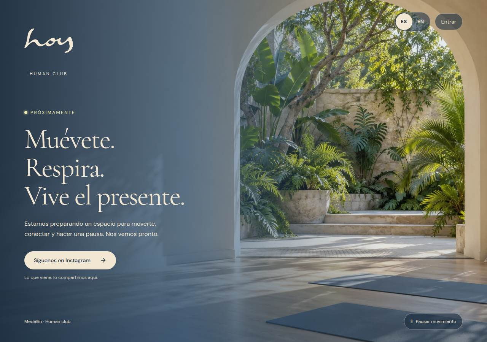
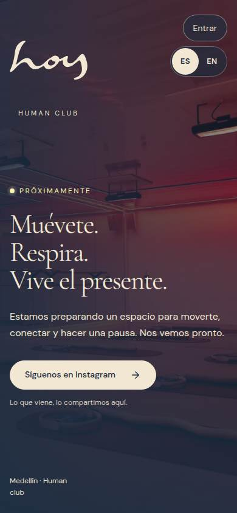
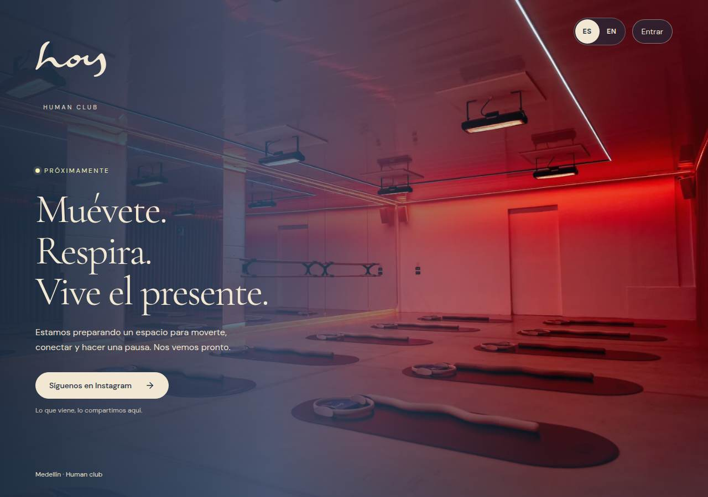
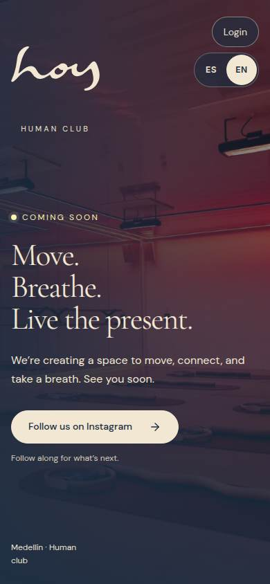

# 0066 · Coming Soon studio photo
version: 0.24.2
date: 2026-10-15
prompt: docs/prompts/0066-coming-soon-studio-photo.md
intent: Update the standalone Coming Soon page with the approved actual studio photo.
decision: Use the wide red-lit studio photo at 480/960/1600 px with the existing readable brand overlay and accurate bilingual alternative text. Remove the obsolete concept video and its video-only playback control. Preserve routing, copy, Instagram and Login-coming-soon behavior.
rejected: Keeping the sanctuary concept loop over a real photo, or cropping a portrait group photo into a full-width studio background.
files: ComingSoonLanding component, CSS and metadata; coming-soon strings; media catalog generator and generated catalog; website and media regression checks; W-11 documentation and screenshots; package version.

## Verification

W-11 is the only changed public page. The source image is already approved and packaged; no original is replaced. The media library records this actual landing placement as live while existing opt-in photo-page placements retain their draft-preview state. The catalog generator also preserves existing direct-photo placements on Plans and Schedule during regeneration.

Full local build, TypeScript, spacing and sample-clock checks passed. The [hosted website suite](https://github.com/imagine-os/hoy/actions/runs/38796916318) passed development, production-bundle and clean root/subpath static-hosting checks against source 166cbd6, with no runtime or media errors; media-library and voucher checks also passed. Browser captures cover Spanish and English on desktop and phone, narrow/tablet layout, static/reduced-motion imagery, image loading and Login dismissal/history/focus behavior.

Baseline before this release, from the previously deployed W-11 captures:

Updated running-page captures:

**Resumen (ES).** La página de preapertura muestra una fotografía real aprobada del estudio con iluminación roja. Conserva el contenido bilingüe, Instagram y el aviso accesible de acceso próximamente.
