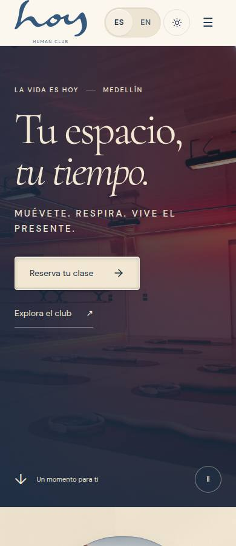
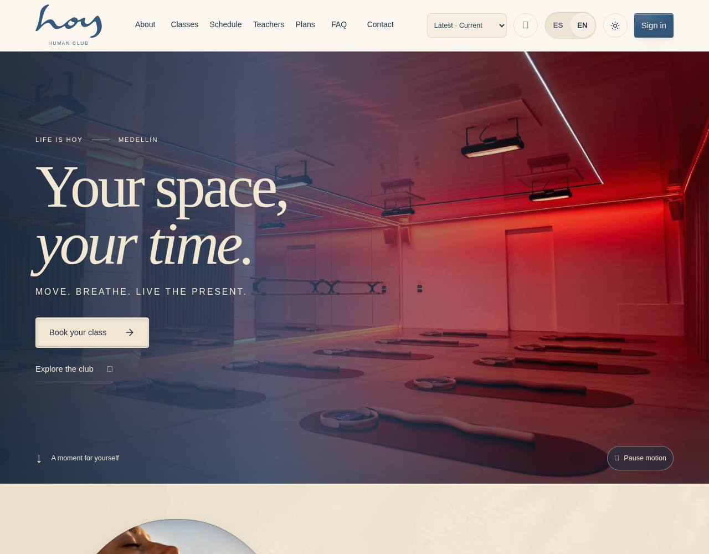
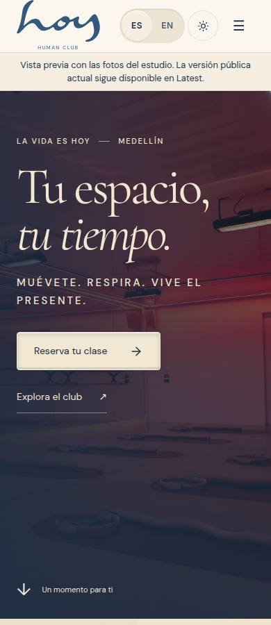
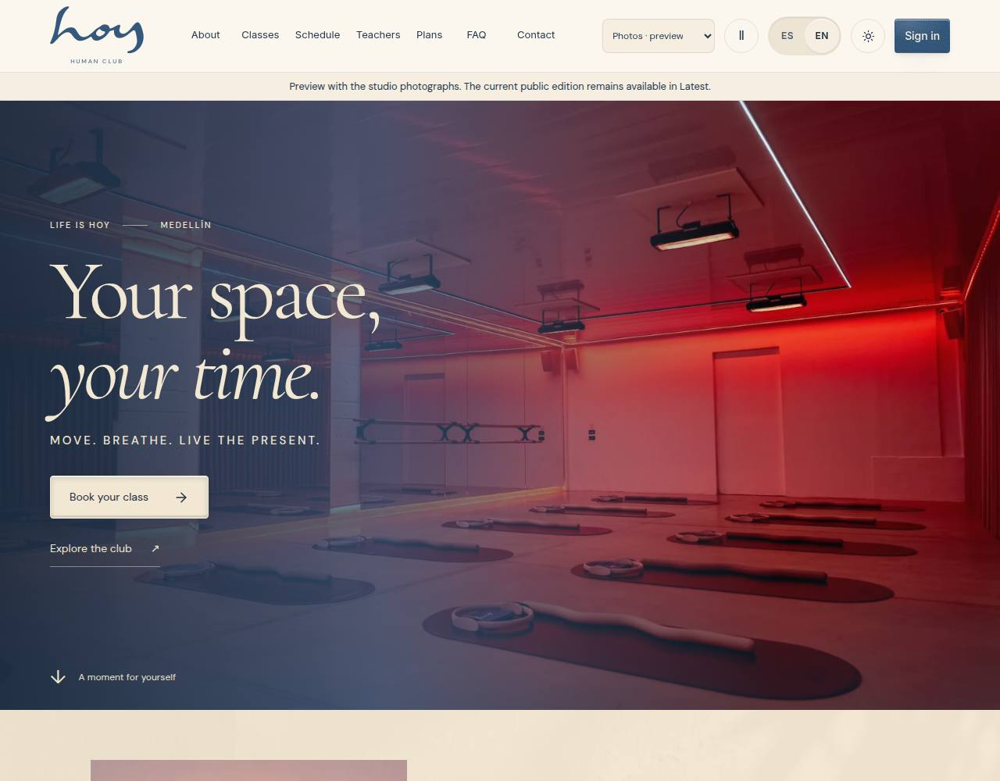

# 0067 · Shared studio hero
version: 0.24.3
date: 2026-10-15
prompt: docs/prompts/0067-shared-studio-hero.md
intent: Give the regular website the same approved hero background as Coming Soon.
decision: Latest and Photos share the actual red-lit studio image, full-bleed cover layout, dark-blue veil and cream copy. Responsive sources preserve mobile image quality. Retain the regular website content and controls.
rejected: Leaving the regular page on generated concept art, retaining a portrait image in the Photos hero, or overwriting historical Archive/Classic treatments.
files: website HomePage, photography and sanctuary styles, strings and specification; media catalog generator and manifest; photography/media-model/shared-hero regression checks; W-01 documentation and captures; package version.

## Verification

Hosted verification covers Latest and Photos in Spanish and English, desktop/mobile and dark mode, narrow/tablet/wide layouts, decoded images, no hero video, cross-edition navigation, CTA targets, Coming Soon image parity and preservation of Archive/Classic. Exact source and capture hashes are checked before release.

**Resumen (ES).** La portada regular y la edición de fotografías comparten la foto real del estudio de la página Próximamente, con velo azul y texto crema legible.
