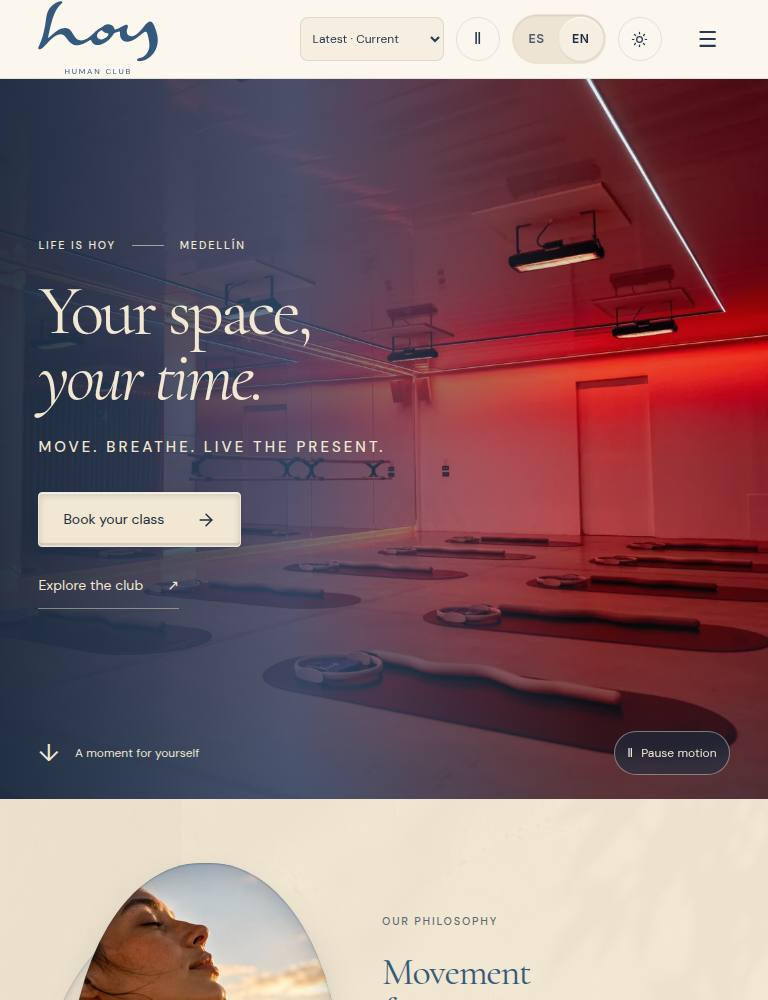

# 0069 · Correct hero capture theme evidence
version: 0.24.5
date: 2026-10-15
prompt: docs/prompts/0069-hero-light-capture-qa.md
intent: Correct misleading narrow/tablet/wide QA capture filenames from the shared-hero test.
decision: Reset English/light storage, reload, and assert the document theme/language before capturing 344/768/3840 widths. Assert theme/language in the full bilingual matrix and record all 19 cases.
rejected: Treating inherited dark captures as light evidence, silently renaming files without verified recapture, or changing customer-facing website code.
files: shared-hero QA script, W-01 extra-width captures/report and documentation; kanban, prompt log and package version.

## Verification

The original 768 capture visibly used a dark header after the preceding matrix's final dark case. The [hosted Photography QA](https://github.com/imagine-os/hoy/actions/runs/38819101830) passed the full build, fresh/cached clock checks, hub routes, 30 photo captures, all 19 language/theme-asserted hero cases and actual customer cache routing. All three regenerated images were inspected and SHA-checked before merge. Exact final-head QA remains required. Website behavior and content are unchanged; release-version metadata is bumped.

**Resumen (ES).** Se corrige la evidencia de pruebas: las capturas de 344/768/3840 se toman y verifican en inglés y modo claro. No cambia el sitio del cliente.

[Previous mislabeled dark tablet capture](https://github.com/imagine-os/hoy/blob/4f8577e38d558ce259344c6afb2bdfd63b2827ee/docs/screenshots/W-01/studio-latest-en-768.jpg)

