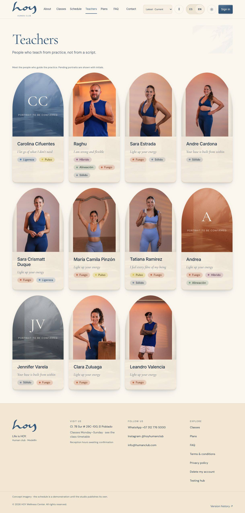
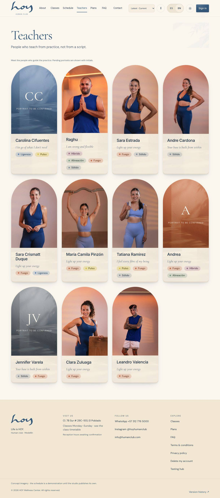
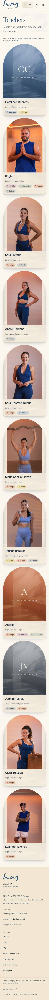
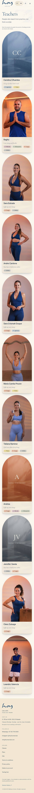

version: 0.25.0
date: 2026-10-26
prompt: docs/prompts/0198-teacher-portrait-frames.md
intent: Remove inset portrait gutters and egg-shaped teacher arches
decision: Follow intrinsic dimensions for verified photos and derive teacher arch radii from card width; preserve CMS framing
rejected: Blanket object-fit cover that crops raised arms, overhead props and full poses; global radius changes
files: src/components/molecule/MediaSlot/MediaSlot.{tsx,css,meta.ts}, src/modules/website/pages/TeachersPage.tsx, src/modules/website/photography.css, scripts/test-teacher-frames-ui.mjs, .github/workflows/photography-qa.yml, docs/pages/W-05.md, docs/screenshots/W-05/portrait-frames-*.jpg

# Teacher frames · W-05

Natural photo geometry removes the cream side gutters without enlarging or replacing the sources. A per-card width container gives the arch equal horizontal and vertical top radii, independent of card/copy height. Only this teacher gallery adopts that geometry. Existing CMS photos keep 4:5 Sanctuary / 4:3 Classic frames and existing fit behavior; verified fallbacks stop zooming into their poses on hover. Teacher IDs, mappings, editions and pending profiles are unchanged.

Before/after images were captured from a running isolated checkout at the reported 1218px viewport and mobile 390px. Regression coverage also includes 768/1280, ES/EN, light/dark, hover, overhead-hand visibility, placeholders, CMS override/reload, intrinsic proportions, gutter detection, clipping geometry and overflow. Exact-head CI and independent review remain required before release.

| Before | After |
| --- | --- |
|  |  |
|  |  |

The two missing PDFs' annotations and bottom-page changes remain outside this repair. No group update, merge or deployment.

**Resumen (ES).** Los retratos verificados conservan su proporción natural, sin franjas laterales ni recortes de poses. Los arcos de profesores tienen una parte superior semicircular calculada por su anchura. Se conserva el comportamiento del CMS y las asignaciones pendientes; faltan dos PDFs para completar el resto del seguimiento.
