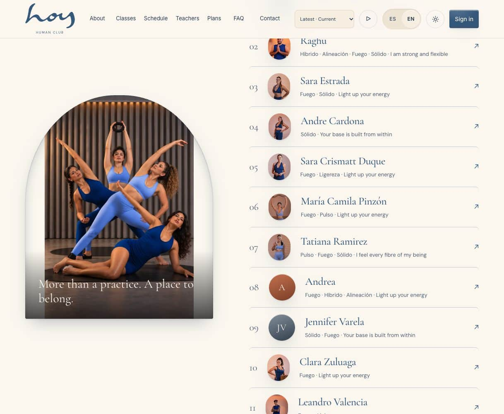
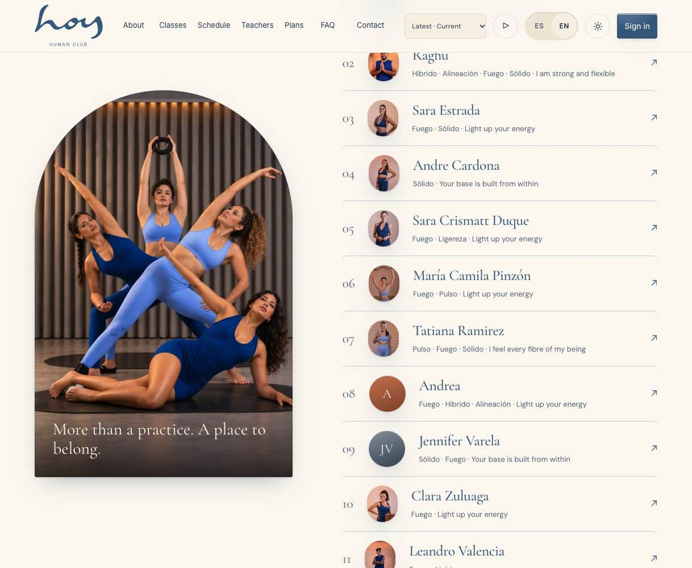
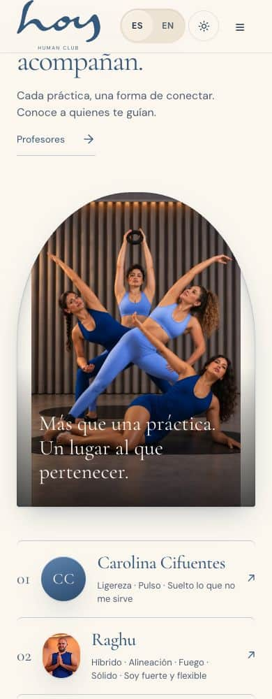
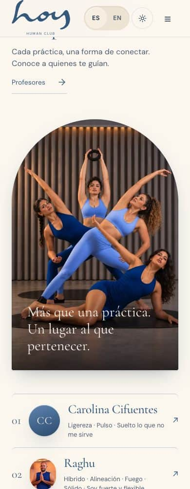

version: 0.25.0
date: 2026-10-26
prompt: docs/prompts/0200-home-group-frame.md
intent: Remove the current Home group-photo side gutters while preserving the four-person composition
decision: Let the verified photo establish its natural height and derive its arch radius from the frame width
rejected: Cover crops, enlargement into people, image replacement and global radius changes
files: src/modules/website/pages/HomePage.tsx, src/modules/website/photography.css, scripts/test-home-group-frame-ui.mjs, .github/workflows/photography-qa.yml, docs/pages/W-01.md, docs/screenshots/W-01/group-frame-*

# Home group frame · W-01

Live visual QA confirmed that a height-capped frame and inherited maximum image height forced the portrait group image into a wider box. `contain` left cream side gutters. The verified source now owns its height, fills the frame without cover cropping or distortion, and keeps a semicircular top measured from its width. Only the current Home studio-group treatment adopts the new geometry. Existing copy, caption overlay, source pixels, teacher identities, CMS portrait overrides, historical editions and held decisions remain unchanged.

Regression coverage compares real before/after browser captures at 1218 and 390. Latest and Photos are checked in ES/EN, light/dark, at 390/768/1218/1280, including natural image/frame geometry, top radii, raised hands/ring/faces inside the clip, motion/hover protection, teacher CMS override/reload, stable teacher list and historical boundaries. Mobile mountain/practice detail checks preserve their current mappings and document scrolling behavior. Independent exact-diff visual review and exact-head CI remain required before release.

| Before | After |
| --- | --- |
|  |  |
|  |  |

**Resumen (ES).** La foto de grupo conserva su proporción original, sin franjas laterales ni ampliación sobre las personas. El arco superior se calcula por anchura. Se mantienen el CMS, las ediciones, el texto y las decisiones pendientes.
