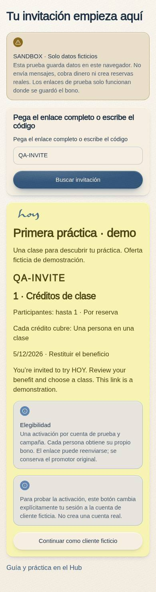

# C-29 · Promotion preview

Route: `/#/promotions/:code`.

Everyone can review the public projection of an available fictional offer. A test customer explicitly claims a personal voucher, then books with that voucher. Repeated claims for the same campaign preserve the original voucher and promoter attribution. Unknown, unpublished or unavailable codes do not expose private context. Real account verification, consent and cross-device claims remain backend prerequisites.

Production boundaries: [promotion backend readiness](../promotion-backend-readiness.md).

## Screenshots

**Resumen (ES):** Flujo de práctica con datos ficticios y almacenamiento local del navegador. No envía invitaciones, no crea reservas reales y no reemplaza las autorizaciones ni los consentimientos de producción.
