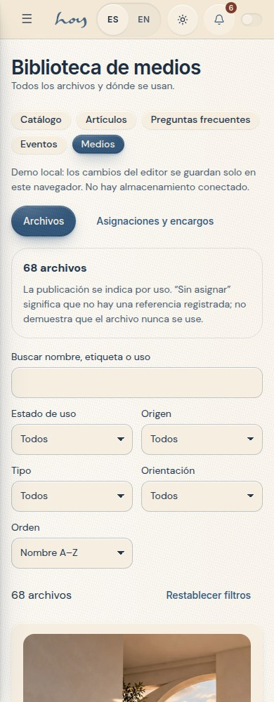
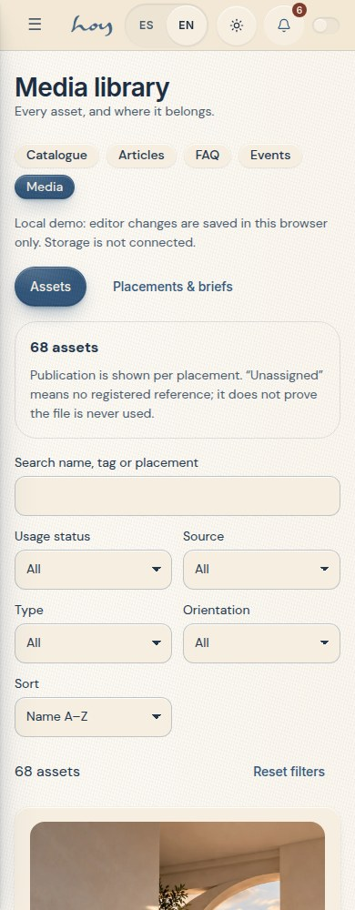
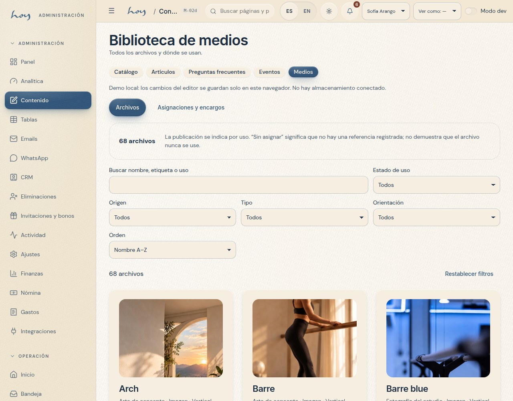
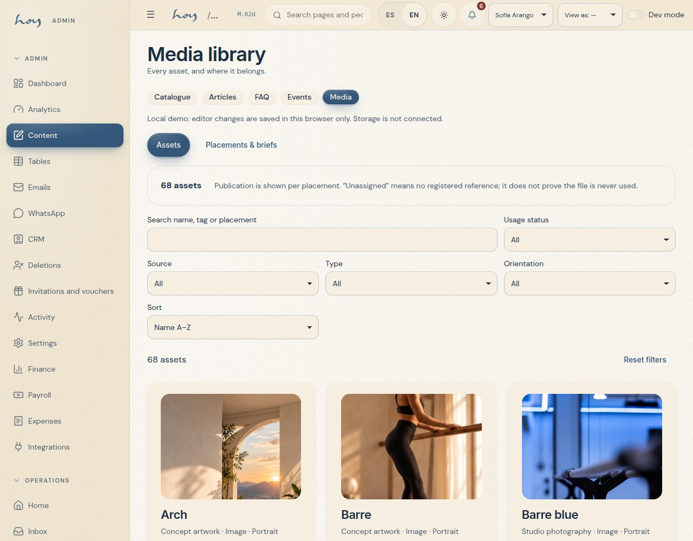
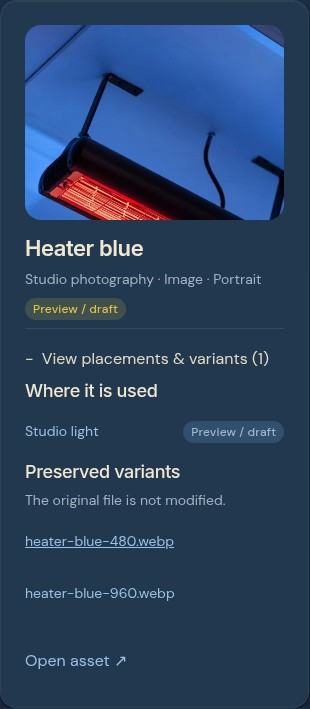
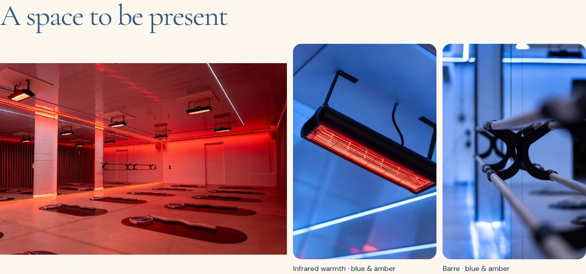
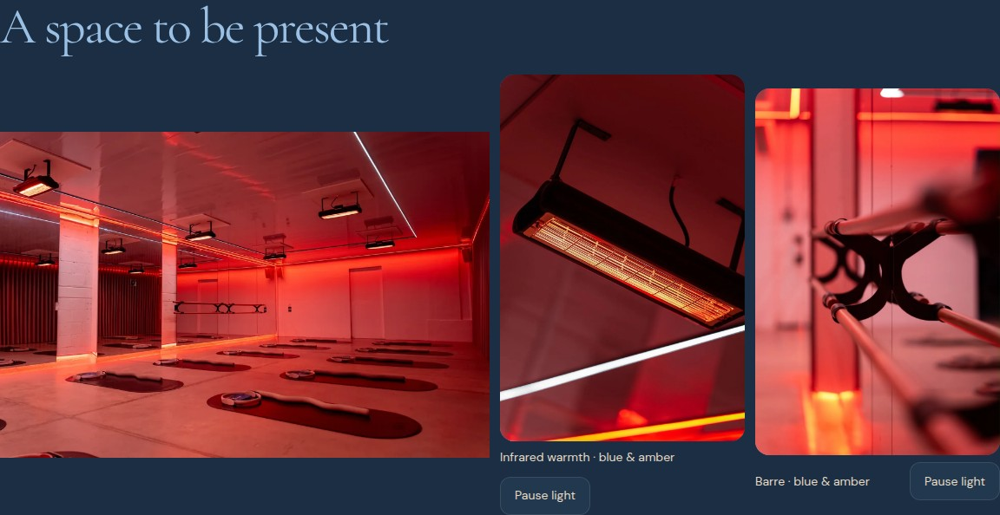
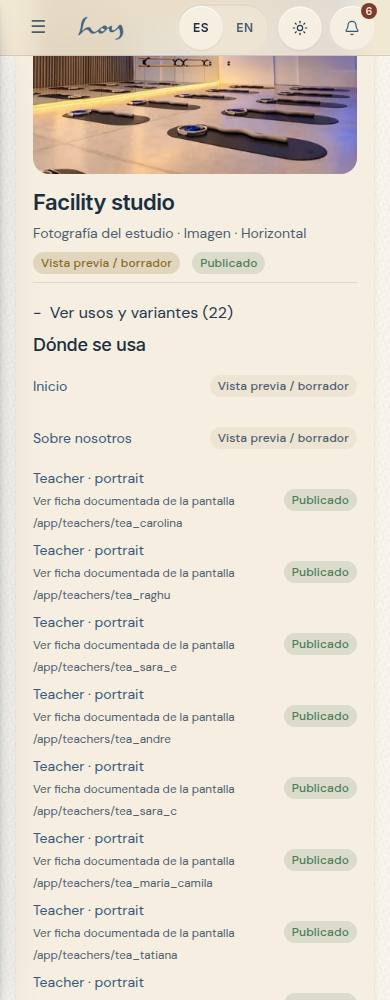
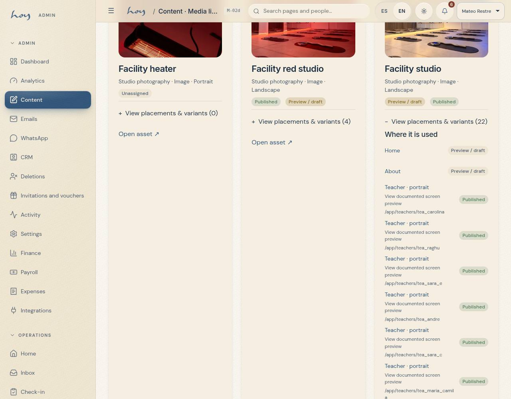

# M-02d — Content · Media library

**Route** `/#/admin/content/media` · **Roles** super_admin, admin, coordinator, marketing · **Surface** admin · **Spec** `spec.code === 'M-02d'` (see `/#/dev/specs`)

## Purpose
A searchable inventory of packaged site files and provider-backed class, teacher and event media. Inspect each placement’s state and route, distinguish original sources from responsive variants, and keep the existing placement editor available. Demo edits stay in this browser; production storage is not connected.

## Screenshots
| ES · mobile | EN · mobile |
| --- | --- |
|  |  |

| ES · desktop | EN · desktop |
| --- | --- |
|  |  |

## View structure

The default Assets view provides name/tag/placement search, source/type/orientation/state filters, name/usage sorting, thumbnails, route links and preserved responsive variants. Placements & briefs opens the existing assignment editor below.

1. `ContentSubNav`
2. `ReadyKPIs (listas / pendientes / video)`
3. `StatusFilter`
4. `MediaGrid → MediaCard (marco con proporción, encargo, URL, alt)`
5. `MarkReady / MarkPending`
6. `AdvancedFields (slot_key, ratio, kind, credit, label, alt, brief)`

## Data
| Table | Read / write | Notes |
| --- | --- | --- |
| `media_assets` | read / write | Assignments; pending or ready in the demo |
| `teachers` | read | Portrait URLs and active gallery status |
| `modalities` | read | Class metadata |
| `events` | read | Cover placements and event status |
| `audit_log` | read / write | |

## Logic and integrations
- slot_key is the contract between the table and the components: MediaPlaceholder({slotKey}) renders the URL when status = ready and a branded empty slot otherwise.
- A row can only be marked ready with a URL; marking it pending again hides the asset everywhere without deleting the record.
- The seed ships one pending row per known slot (class hero 16:9, teacher portrait 4:3, event 4:5, studio tour video 16:9, site hero 21:9, about 4:3, contact map), so the owner reads the page as a to-do list.
- HoyOS stores the URL, never the binary: uploads belong to Supabase Storage when it lands.
- Production integration pending: Supabase Storage
- Static files are discovered at build time. Provider rows remain reactive. Live/draft/archive/inactive state belongs to each placement, not the entire file. An inactive teacher can still have a live deep-linked profile; this is shown separately.
- Unassigned means no indexed reference, not proof that a file is never used. Static references describe a code placement and can be affected by saved layout, edition, or motion settings.

## States
- Loading
- Empty
- Pending slot (ratio + brief)
- Ready photo
- Ready video
- Invalid URL
- Read-only

## Real vs mock
- Real: the page renders from the data layer (`useData()` / `useTable`) over the tables above; every write goes through the `DataProvider` so the Supabase provider replaces the mock unchanged.
- Mock / pending: Supabase Storage are simulated or deferred; data is the browser-local `MockProvider` seed.
- Note: Sub-page of M-02; the sub-navigation is shared by all five.
- Note: Every write appends an audit_log row through useAudit('admin').

## Changelog
- [0065 media library](../changelog/0065-media-library.md) — catch-all catalog, provider references and per-placement state
- `docs/changelog/0005-final-integration.md` — screenshots and this page doc (v0.3.0)

---
**Resumen (ES).** Biblioteca de archivos con búsqueda, filtros, variantes y enlaces a cada uso. Los cambios del editor se guardan solo en el navegador hasta conectar el backend.

## Placement detail and color-pair previews

The equipment gallery uses a 40-second dissolve in the opt-in photo edition. Pause applies to both pairs; reduced motion renders a still. Both color originals remain separate, and color is not a publication state or a day/night claim.

## Role-safe placements and bilingual search · 0068

Search includes the same Spanish and English placement names shown in the inventory, including accent-free queries such as `proximamente`. Admin, coordinator and marketing users keep their existing permissions. A customer-only placement links to its public documented screen instead, labelled “View documented screen preview” / “Ver ficha documentada de la pantalla” and showing the original runtime path. Authorized public placements still open directly. An unresolved target is labelled unavailable rather than linking to a broken page.

[Repair details and evidence](../changelog/0068-media-navigation-demo-clock.md).
