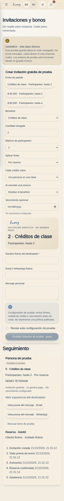
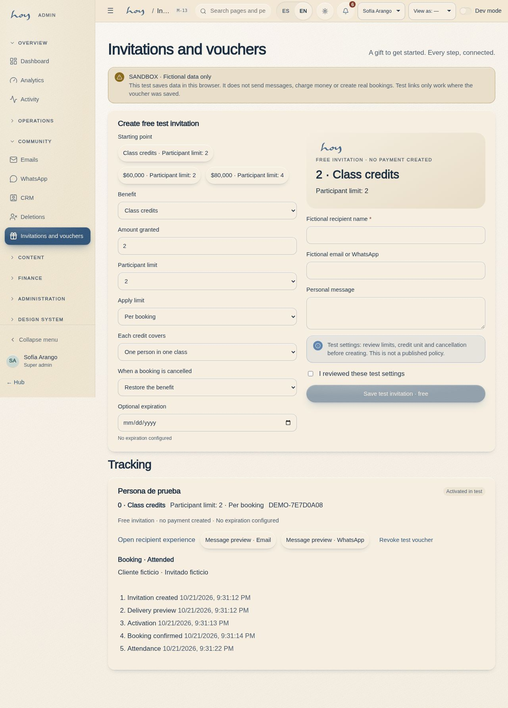

# M-13 · Invitations and vouchers

Route: `/#/admin/vouchers`. Admin/super-admin testing surface. All details are fictional, browser-local data. Create class-credit or COP invitations without a purchase, review policies, preview delivery, inspect guests, cancel, record attendance and review history. Every write passes through the voucher domain command seam.

Production status and remaining requirements: [backend readiness](../voucher-backend-readiness.md).

## Screenshots

