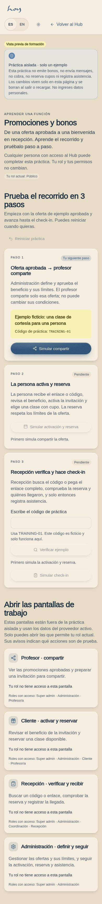
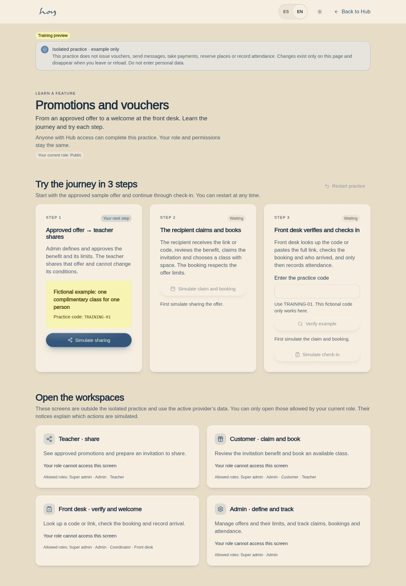

# P-02 · Promotions · learn and practise

Route: `/#/hub/promotions`.

Everyone with access to the Hub can open this guide without changing identity or permissions. The three-step rehearsal uses only component state: simulate sharing, simulate claim and booking, verify the practice code, then simulate attendance. Invalid codes cannot advance. Restart, reload or leaving clears practice. Workspace links respect the current role. This is not a real invitation, booking or authorization gate.

Production boundaries: [promotion backend readiness](../promotion-backend-readiness.md).

## Screenshots

**Resumen (ES):** Flujo de práctica con datos ficticios y almacenamiento local del navegador. No envía invitaciones, no crea reservas reales y no reemplaza las autorizaciones ni los consentimientos de producción.
