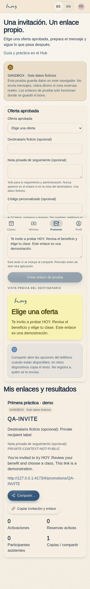
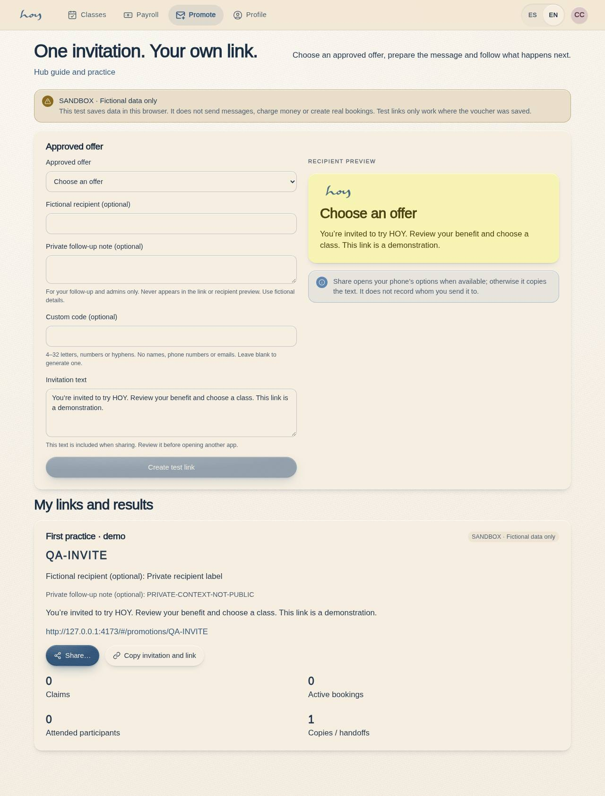

# S-07 · Promote an invitation

Route: `/#/teach/promote`.

Teachers, admins and super admins choose a published, approved fictional offer. Each invitation gets a unique code and link, optionally with private recipient context. Review the message, copy it or open native sharing. Copy and share handoff never mean delivered. Private context stays out of recipient previews and URLs. This browser-local demo does not fulfill links on another device.

Production boundaries: [promotion backend readiness](../promotion-backend-readiness.md).

## Screenshots

**Resumen (ES):** Flujo de práctica con datos ficticios y almacenamiento local del navegador. No envía invitaciones, no crea reservas reales y no reemplaza las autorizaciones ni los consentimientos de producción.
